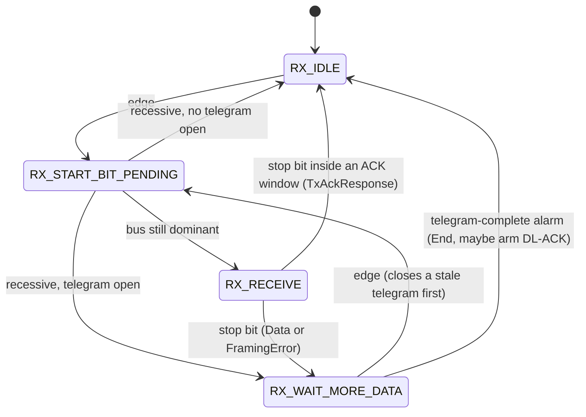

# TP1 bit-bang ISR: specification

This document specifies the interrupt-driven TP1 character and acknowledge
engine, `BitBangDriverTimerIsrT`
(`include/knx/physical/bitbang_driver_timer_isr.hpp`,
`src/physical/bitbang_driver_timer_isr.cpp`). It describes the engine as it is
now. The code cites its sections as §n.

The invariants (§5) and the event contract (§6) are executable. In host builds
the ISR checks them after every interrupt, every `send()` and every queued
event (`KNX_TP1_BITBANG_SELF_CHECK`), and aborts with the rule's identifier
(`I7`, `E2`, …) on a violation. Every TP1 test therefore also tests this
specification. When the behaviour has to change, change this document in the
same commit.

Spec references are to KNX Standard v3.0.0, Volume 3 Part 2 Chapter 2
(03_02_02, Communication Medium TP1), unless another part is named.

## 1. Scope and position in the stack

```
Tp1DataLinkLayer            frame encode/decode, repetitions, confirmations
  └ Tp1MacPhysical          frame-level send/receive, TX outcome, RX queue, BUSY policy
      └ BitBangMediumBackendAdapter
          └ BitBangDriverTimerIsrEspIdf   task-side pump: ISR events → Tp1RxEvent   (target)
            VirtualBitBangTp1Driver       the same pump for host tests              (host)
              └ BitBangDriverTimerIsrT    ← this document: two ISRs + send()
                  └ IsrPolicy / timer_gpio_hal   GPIO and timer access
```

The engine owns everything with a deadline shorter than a task can meet:

- **Bit timing.** Sampling received bits and driving transmitted ones.
- **The acknowledge decision.** It is due t_ack = 15 bit times after a frame.
- **Bus access.** The idle wait, arbitration and retry after arbitration loss.
- **The ACK window** of the frame it sent.

It owns no policy above that. Repetitions, confirmations, the RX queue and the
BUSY decision (published to it as `setLocalBusy`) belong to the layers above.

## 2. Execution contexts and ownership

| Context | Entry points | May write |
|---|---|---|
| Timer interrupt | `onTimerAlarm()` | all ISR state |
| GPIO edge interrupt | `onRxEdge()` | all ISR state |
| Task, under the ISR lock | `send()`, `setAck*Addresses()`, `setQueueNotifyCallback()` | TX staging fields, the TX alarm, ACK tables, notify pair |
| Task, no lock | `setOwnAddress`, `setLocalBusy`, `setBusMonitorMode`, `setGroupAckFilter` | one aligned word each, read atomically by the ISR |
| Task (one consumer) | `popMessage()` | `_msgHead` only |

Both interrupts run at the same priority (level 3) on a single core, so they
never preempt each other, and the ISR lock (`lockFromTask`) masks them both.
Every interrupt handler therefore runs to completion against a consistent
state. The invariants of §5 hold at every interrupt exit and at every release
of the ISR lock.

The event ring is single-producer single-consumer. Its free-running 32-bit
indices are published with release/acquire ordering, and there is no shared
count.

## 3. State

### 3.1 Receiver

`_rxState` samples one character at a time:

| State | Meaning | RX alarm |
|---|---|---|
| `RX_IDLE` | no character in progress | none |
| `RX_START_BIT_PENDING` | a dominant edge seen; re-read pending | edge + `startBitValidationTimeUs` |
| `RX_RECEIVE` | sampling D0–D7, parity, stop | next sample point |
| `RX_WAIT_MORE_DATA` | character complete; waiting for the next one or the telegram end | stop sample + 3 bit times |



A **telegram** is the run of characters from the first `Data` or error
message to `End`. `_rxTelegramOpen` marks that an `End` is owed. The
per-telegram state is `_rxByteCount`, `_rxCheckXor`, the destination octets,
the frame format and `_rxAckIntent`. It is reset in exactly one place,
`finishRxTelegram()`, which also queues `End`.

Rules that are easy to break:

- **Validated start bits only.** `_lastCharStartUs` is set only when a start
  bit is validated (`processStartBit`), never for a rejected glitch.
- **Glitches keep the telegram's deadline.** A glitch between two characters
  of a telegram returns to `RX_WAIT_MORE_DATA` under the previous character's
  telegram-complete deadline. Dropping to `RX_IDLE` there would leave the
  telegram open forever and append the next telegram to it.
- **Stale telegrams are closed.** An edge more than 16 bit times after the
  last character start closes the open telegram before it starts a new one.
  This only happens if a telegram-complete alarm was missed.
- **ACK-window characters are not telegrams.** In `TX_WAITING_ACK` a
  character belongs to the ACK transaction. Its errors are reported through
  `TxAckResponse` (as `ACK_BYTE_NONE`), never as `ParityError` or
  `FramingError`, and it opens no telegram.
- **Own transmissions stop reception.** `abandonReception()` runs when this
  node starts a DL-ACK and when it finishes a frame or a DL-ACK. A character
  overlapping its own decodes as the wired-AND of both, and its own echo
  dirties the sampler. An open telegram is closed with `End`, so the consumer
  never sees a telegram that does not end.

### 3.2 Transmitter

| State | Meaning | TX alarm |
|---|---|---|
| `TX_IDLE` | nothing staged | none |
| `TX_WAITING_SLOT` | a frame waits for the bus, or a DL-ACK waits for t_ack | next CSMA evaluation / t_ack |
| `TX_SENDING_ZERO_ACTIVE` | driving the 35 µs dominant part of a `0` | end of the pulse |
| `TX_SENDING_ZERO_EQUALIZATION` | released; rest of the `0` bit cell | end of the bit |
| `TX_SENDING_ONE` | released; a recessive bit, stop bit or inter-character gap | end of the bit / gap |
| `TX_WAITING_ACK` | frame sent; ACK window open | window end (frame end + 35 bit times) |

Bit positions in `_txBitPosition` (and `_rxBitPosition`) are −1 for the start
bit, 0–7 for data, 8 for parity and 9 for stop. `_txBitPosition` names the
position the next bit-end will service, so the bit on the wire is the one
before it. The receiver never samples position −1: the start bit is confirmed
by its re-read, which schedules the D0 sample directly.

A dominant edge where this node sends a recessive bit, outside a DL-ACK, means
another sender won arbitration (§3.4). Other edges while this node drives a
bit are its own echo, or the same 0 from a sender still level with it. They
are ignored, apart from setting `_rxZeroDetected`.

### 3.3 Composite transmitter modes

The transmitter's real state combines `_txState`, `_sendingAck` (with its
octet `_ackSlotByte`) and `_txTelegramLength` (a frame is staged). These are
the legal combinations; I4–I8 in §5 enforce them.

| Mode | `_txState` | `_sendingAck` | frame staged |
|---|---|---|---|
| Idle | `TX_IDLE` | no | no |
| Frame waiting for the bus | `TX_WAITING_SLOT` | no | yes |
| DL-ACK armed | `TX_WAITING_SLOT` | yes | no |
| DL-ACK armed, frame behind it | `TX_WAITING_SLOT` | yes | yes |
| Sending a frame | `TX_SENDING_*` | no | yes |
| Sending a DL-ACK | `TX_SENDING_*` | yes | either |
| ACK window open | `TX_WAITING_ACK` | no | no |

**The DL-ACK slot.** The decision is taken while the header streams in. As
soon as the destination address and its type are known, `armAckIfAddressed()`
latches ACK or BUSY in `_rxAckIntent` (this is the `EarlyAckArmed` event).
That value belongs to the telegram and is cleared with it.

When the telegram completes, `rxHandleTelegramComplete()` does three things:

- downgrades the intent to NAK if the telegram is not correct (character
  error, wrong check octet or impossible length, 03_02_02 §2.4.2);
- moves the octet into `_ackSlotByte`;
- hands the timeline to the slot.

From then on the slot is independent of the receiver. In particular, another
device's acknowledge that starts before this node's own (the acknowledges of
all addressed devices superimpose) cannot cancel it.

**Staging behind a DL-ACK.** `send()` accepts a frame while a DL-ACK is armed
or on the wire. The ACK goes first, then the frame takes the normal bus-idle
wait, measured from the ACK's start bit. This saves the busy/retry round trip
for the response a task sends right after a request.

### 3.4 Arbitration loss

The trigger is a dominant edge in a bit cell where this node sends a 1,
outside a DL-ACK. `txEdgeLostPosition()` decides which cell an edge belongs
to from its time on the TX bit grid, not from `_txState` alone:

| Edge arrives | Belongs to | Arbitration lost if |
|---|---|---|
| in the dominant part of a 0 | this cell (own echo) | never |
| in the last quarter of a cell, or after the cell's alarm is due | the next cell | the next bit is a 1 |
| anywhere else in a 1 | this cell | always |
| anywhere else in the recessive part of a 0 | this cell (late echo) | never |

The second row is needed because two senders are never level to the
microsecond, and because the edge interrupt can run before the alarm that
ends the cell even when the edge came after it (both pending, the GPIO
interrupt dispatched first). Without it, an edge a few microseconds early is
charged to the wrong bit: a loss is missed (the cell on the wire was a 0), or
found one bit early (it was a 1), or found where both senders send the same 0.
The split is a quarter of a cell and not a half, because interrupt latency
only makes an edge look later than it was.

The next cell of the stop bit and gap is the start bit, which every
synchronised sender sends, so an edge just before it is not a loss. An edge
elsewhere in the stop bit or the gap is a sender that is not synchronised
with this frame.

`loseArbitration()` then does the following:

1. Queues `Collision`.
2. If the lost bit is inside a character, hands that character to the receiver
   (`takeOverReceptionAfterArbitrationLoss`). Up to the bit where the two
   frames diverged, the wired-AND bus carried exactly what this node sent. So
   the octets already sent are published as the winner's first `Data`
   messages, and folded into the check octet and the header decoder. The
   current character continues in `RX_RECEIVE` from the diverging bit, which
   `_rxZeroDetected` makes a 0. Its sample point is the middle of that bit's
   cell, so it lies ahead whether the edge came early or late. The winner's
   frame is then received whole, and acknowledged if it is addressed here.
3. Otherwise (stop bit or gap), leaves the receiver idle, so the same edge
   starts a character as a start bit.
4. Puts the frame back into `TX_WAITING_SLOT`. Its pending alarm makes the
   slot poll every bit time until the receiver is idle, then the normal
   bus-idle wait applies. After `MAX_TX_ARBITRATION_ATTEMPTS` losses the frame
   is abandoned with `TxArbitrationLost`.

Losing arbitration is how TP1 shares the bus, not an error. It does not touch
the data link's BUSY or NAK budget.

### 3.5 Joining a start bit

A frame comes due at one instant: the end of the bus-idle wait (§4.2). Every
other sender of the same access class comes due at the same instant, and
bitwise arbitration is meant to decide between them. A sender a few
microseconds ahead has its start edge seen before this node's slot alarm
runs. Waiting for it, as for any character in progress, would give it the bus
whatever the two frames' priorities are.

So when the slot alarm is the one scheduled for the due instant
(`_txSlotDueUs`) and the receiver holds nothing but a start bit that began at
most a quarter of a bit before it on the bus (`startBitJustBegan()`), the node
sends its own start bit at its own instant. The receiver's view of that start
bit is dropped. From there on the two senders are on one grid: the other
sender's edges come just before this node's cell ends, where §3.4 attributes
them to the right bit, and if it wins, the takeover receives its frame whole.

The bound is the one §3.4 uses, and it is measured on the bus: the reaction
latency (§4.4) is added to the distance between the two timestamps. A start
bit further ahead than that is a sender that got the bus first, and the frame
waits behind it. So does any character but the first of a telegram.

## 4. Timing schedule

All times are in µs on one free-running 64-bit timer. The configuration
supplies the serial bit time `bit` (104), `bitSamplingOffsetUs` `s` (52),
`startBitValidationTimeUs` `v`, `zeroActiveTimeUs` (35) and
`zeroEqualizationTimeUs` (69). Derived constants are computed once in
`init()`.

### 4.1 Anchoring

A handler returns a delay relative to the instant its alarm was **scheduled**
for (`firedAlarmUs`), not to the current time. Only `onTimerAlarm()` turns
that delay into a deadline. A whole character, a whole frame and the DL-ACK
are therefore locked to one edge and never accumulate interrupt latency.

Three deadlines are anchored elsewhere:

| Deadline | Anchor |
|---|---|
| start-bit re-read | the edge timestamp in `onRxEdge()` |
| first CSMA evaluation of a staged frame | now + 1 bit, in `send()` |
| sample point after arbitration takeover | the lost character's start bit |

Cancelling a deadline (writing 0) is allowed wherever a timeline is
abandoned. Every write is followed by `rearmTimer()` before the interrupt or
the lock section ends.

### 4.2 Schedule of one exchange

The character start `t0` is the validated edge (RX) or the scheduled start-bit
alarm (TX).

| Event | Time |
|---|---|
| start-bit re-read | `t0 + v` |
| sample of bit position k (0…9) | `t0 + s + (k+1)·bit` |
| telegram complete (after the last stop sample) | `+ 3·bit` = frame end + 2·bit + s |
| DL-ACK start bit | telegram complete + (13·bit − s) = frame end + 15·bit (t_ack), less the reaction latency (§4.4) |
| TX: dominant part of a `0` | `zeroActiveTimeUs`, then `zeroEqualizationTimeUs` |
| TX: character to character | 11·bit + 2·bit gap |
| ACK window (own frame) | opens at the last stop bit, closes frame end + 35·bit |
| bus-idle wait before a frame | last character start + (11 + 50)·bit (system, urgent, and every repeated frame) or (11 + 53)·bit (normal, low); less the reaction latency when that character was received (§4.4) |
| after a BUSY acknowledge | additionally ≥ BUSY start + (11 + 150)·bit (A.8), less the reaction latency |

The tightest margin in the driver is the start-bit re-read. The dominant pulse
lasts 35 µs, so edge-ISR entry latency plus alarm lateness plus `v` must stay
below it. `linkCounters().startValidationRejects` counts misses.

### 4.3 One hardware compare for two timelines

RX and TX each keep a deadline (`_rxAlarmUs`, `_txAlarmUs`, 0 = none).
`rearmTimer()` programs the earlier of the two (RX on a tie: a sample cannot
wait, a TX transition only moves by one ISR) and records which one it
programmed (`_armedAlarmOwner`, `_armedAlarmUs`).

`onTimerAlarm()` consumes that record. It services the deadline only if it is
still that timeline's deadline. Otherwise it counts
`linkCounters().staleTimerAlarms` and rearms. This makes a compare that
survived a reprogram harmless.

The RX→TX hand-off (arming the DL-ACK slot) is the one case where an RX
handler's delay schedules the TX timeline: the handler returns a delay while
leaving the receiver idle.

### 4.4 Reaction latency

Two constant delays lie between the bus and the schedule:

- A received edge is timestamped late: the transceiver's receive delay plus
  the GPIO interrupt's latency up to the timer read.
- A scheduled transition reaches the bus late: the timer interrupt's latency
  up to the pin write plus the transceiver's transmit delay.

Their sum is the **reaction latency** (`reactionLatencyUs`,
`CONFIG_KNX_TP1_BITBANG_REACTION_LATENCY_US`). Where it matters depends on
what a delay runs from and to:

| Delay | From → to | Effect of the latency | Compensated |
|---|---|---|---|
| bits and characters of a frame or DL-ACK this node sends | own drive → own drive | every transition is late by the same amount; the waveform on the bus is exact | no |
| sample points of a received character | stamped edge → sample | edges are latched, and both ends shift together | no |
| idle wait after a character this node sent | own drive → own drive | the idle time on the bus is exact | no |
| DL-ACK at t_ack after a received frame | bus edge → own drive | the acknowledge is late, and wider where it superimposes on others | yes |
| idle wait after a received character | bus edge → own drive | the frame starts late and seldom arbitrates | yes |
| wait after a BUSY acknowledge | bus edge → own drive | the repetition is late | yes |

`_lastCharStartIsOwn` records which kind the CSMA reference is, and
`referenceLatencyUs()` returns the latency or 0 accordingly. Taking it off a
delay that runs from this node's own character would shorten the idle time on
the bus below the 50 or 53 bit times.

Only the constant part can be taken off. Interrupt jitter stays, so the value
to configure is the smallest latency the board shows: then nothing is ever
driven early. With `CONFIG_KNX_TP1_BITBANG_TIMING_STATS` the driver measures
it as `txEchoDelayUs`, the time from the scheduled start bit of a frame to the
timestamp of its own echo, which passes through all four parts once. The
default is 0, which compensates nothing.

## 5. Invariants

These hold whenever no interrupt is running and the ISR lock is free.
`selfCheckState()` checks them in host builds.

| Id | Invariant |
|---|---|
| I1 | The armed compare is the earliest nonzero deadline, RX winning ties, and is recorded with its owner. |
| I2 | `_rxState == RX_IDLE` ⇔ no RX deadline. |
| I3 | `_txState == TX_IDLE` ⇔ no TX deadline. |
| I4 | `_sendingAck` ⇔ `_ackSlotByte != 0`. |
| I5 | A pending DL-ACK is never in `TX_IDLE` or `TX_WAITING_ACK`. |
| I6 | No frame is staged in `TX_IDLE` or `TX_WAITING_ACK`. |
| I7 | `TX_WAITING_SLOT` always has something to send (a DL-ACK or a frame). |
| I8 | Driving bits outside a DL-ACK means a frame is staged. |
| I9 | An acknowledge intent exists only inside an open telegram. |
| I10 | An open telegram means the receiver is not idle. |
| I11 | An idle receiver holds no octet count and no errors. |
| I12 | An accepted `send()` without its terminal event ⇔ a frame staged or an ACK window open. |
| I13 | `_rxTelegramOpen` agrees with the event stream (an `End` is owed). |
| I14 | Between `DlAckTxStart` and `DlAckDone` exactly while a DL-ACK is driven. |

## 6. Event contract

Events reach the consumer in the order they were produced, through a
128-entry ring. In the grammar below, `*` means zero or more, `?` optional and
`|` alternatives. `selfCheckMessage()` enforces it as each event is produced,
including events the ring then drops.

**Per received telegram:**

```
( Data | ParityError? Data | ParityError? FramingError )+  End  DlAckSuppressed?
```

- `EarlyAckArmed` may appear at most once, anywhere after the first event of
  the telegram and before `End`.
- `End.data` is the RX error flags (bit 0 parity, bit 1 framing) plus
  `END_FLAG_ANSWERED_BUSY` (0x80). That flag means the telegram was answered
  with BUSY. The sender will repeat it, so the consumer must not deliver this
  copy.
- An acknowledge between two other devices is an ordinary one-octet telegram.

**Per accepted `send()` (E4, E5, E9):**

```
( Collision ( Data* ) )*  TxFrameEnd?  ( TxComplete | TxAckResponse | TxArbitrationLost )
```

- Exactly one terminal event follows, and `send()` is not accepted again
  before it.
- `Collision` may be followed by the winner's telegram, which is a received
  telegram in its own right.
- `TxAckResponse.data` is the acknowledge octet received in the window (ACK
  CCh, NAK 0Ch, BUSY C0h, NAK+BUSY 00h), or `ACK_BYTE_NONE` (FFh) when none
  arrived intact.
- `TxFrameEnd` exists only with `CONFIG_KNX_TP1_BITBANG_TIMING_STATS`.

**Per DL-ACK this node sends (E1, E6, E7):**

```
DlAckTxStart  DlAckDone
```

Nothing is queued between the two.

**Wake-ups.** Every event except `Data`, `EarlyAckArmed`, `DlAckTxStart` and
`TxFrameEnd` calls the notify callback. So does any event that brings the ring
to half full. Each excluded event is always followed by one that notifies.

**Overflow.** A full ring drops the event and counts it in
`droppedMessageCount()`. A dropped terminal event leaves the MAC to its own
timeout (`setTxOutcomeTimeoutMs`).

### 6.1 How the layers above use the events

| ISR event | Task-side pump (`BitBangDriverTimerIsrEspIdf::process`) | MAC (`Tp1MacPhysical`) |
|---|---|---|
| `Data` … `End` | assembles the telegram; delivers it unless `END_FLAG_ANSWERED_BUSY` | queues it; asserts `setLocalBusy` when the queue nears full |
| `ParityError`, `FramingError` | `ReceiveError` event; a single-octet framing "error" that is an ACK octet becomes `RxAckObserved` | logs |
| `TxAckResponse` | `TxAckResponse` (ACK class) or `TxAckDeadlineMiss`; state → Idle | latches the outcome: ACK → ok, BUSY → `Busy`, NAK/none → `TransmissionFailed`, miss → `Timeout` |
| `TxArbitrationLost` | `TxAckResponse` with class `None`; state → Idle | `TransmissionFailed` |
| `TxComplete` | state → Idle (no event) | the frame expected no ACK: waits for the state to leave `Transmitting` |
| `Collision` | `MediumStateChanged` | — |
| `DlAck*`, `EarlyAckArmed` | diagnostics and bus-monitor trace only | — |

Both sides must agree on whether a frame opens an ACK window. The ISR decides
in `txFrameExpectsAck()` (every frame except one to the individual address
FFFFh, unless the A bit is set). The MAC repeats the same rule in
`beginTransmit()` to choose between waiting for an outcome event and waiting
for the state. See §9 for the consequence.

## 7. Platform and performance

The ISR core is a template over an `IsrPolicy`. On the target this is
`EspIdfIsrHalPolicy`, whose operations are always-inline register accesses:

- **Timer read and rearm.** On chips with one timer per group (ESP32-C2, C3,
  C5, C6, C61, H2: `KNX_TP1_BITBANG_TIMER_DIRECT`) these go through the TIMG
  registers. A read is a latch plus two loads; a rearm is three stores. The
  gptimer driver still allocates, clocks and starts the timer, but is not on
  the hot path. On chips with two timers per group the driver does not reveal
  which one it allocated, so the gptimer API is used there.
- **Timer interrupt.** On the register path the HAL allocates the alarm
  interrupt itself (IRAM, level 3). That skips the driver's handler, which
  latches the counter, takes a spinlock and calls through a callback.
- **GPIO edge interrupt.** It goes through the shared GPIO ISR service (the
  application may attach other pins to it). The ISR core's handler is
  registered directly, with no HAL shim in between.
- **TX drive and RX level.** Single writes to `GPIO.out_w1ts`/`out_w1tc` and a
  read of `GPIO.in`.

Inside the core:

- **No timer reads on the TX path.** Every TX transition is scheduled from the
  alarm's scheduled instant, including the character-start stamp used for
  CSMA. The only reads are on an RX edge and in `send()`. An edge in the
  recessive part of a transmitted cell costs one read (§3.4); the node's own
  echo, which comes in the dominant part, costs none.
- **No multiplications in the ISR.** All derived timing is precomputed in
  `init()`.
- **No library calls.** Parity is a shift-XOR fold (RV32IMAC has no popcount
  instruction). The group table is binary-searched by hand.
- **Hot fields first.** Every field an interrupt touches on its common path
  sits at the start of the object, followed by the HAL policy and the ring
  indices. Cold tables, the ring storage and the TX buffer come after. On
  RV32 this keeps every hot access a single load or store with a 12-bit
  immediate offset from the object base. On a cached target it keeps the
  working set in a few cache lines. (The ESP32-C6 internal SRAM is not
  cached; there the cost to avoid is flash, which is why all of the following
  apply.)
- **Everything reachable from either interrupt is in IRAM**
  (`KNX_TIMER_GPIO_HAL_ISR_ATTR`) and touches only internal RAM, so the
  driver keeps working while the flash cache is off during NVS commits. This
  includes the coupler's `GroupAckFilter` table.

With `CONFIG_KNX_TP1_BITBANG_TIMING_STATS` the driver measures per-ISR cycle
counts, alarm jitter and per-bit TX lateness, and attaches timestamps to
events for the bus-monitor trace. With it off, all of this compiles to
nothing.

## 8. Testing

- **Self-check.** `KNX_TP1_BITBANG_SELF_CHECK` (host default on, target
  off). It checks the invariants of §5 and the grammar of §6 everywhere the
  ISR runs in a host test. White-box tests that write internal fields directly
  turn it off for that test with `setSelfCheckEnabled(false)`.
- **ISR unit tests** (`test/unit/test_bitbang_driver_timer_isr.cpp`). Each
  bit, the acknowledge decision, the ACK window, the bus access classes,
  arbitration loss with takeover (with the winner late and early on the bit
  grid), joining a start bit, the reaction latency, the BUSY hold-off, and
  acknowledges that superimpose.
- **Virtual-bus tests** (`test_tp1_bitbang_virtual_*`). Timing faults, edge
  loss and duplication, jitter, stale alarms.
- **Stack tests above the MAC** (`test_bau_onwire`,
  `test_tp1_datalink_virtual_bus_conformance`, …). These run the real ISR on
  the virtual bus.

The virtual bus does not echo this node's transmission onto its receive line.
Tests of arbitration therefore script the winner's waveform only.

## 9. Known limits

- **Duplicated ACK-window rule (open).** The MAC duplicates the ISR's "does
  this frame open an ACK window" rule, and `TxComplete` produces no event, so
  a frame without an ACK window is confirmed by polling the medium state. A
  frame to FFFFh that is abandoned after repeated arbitration loss is
  therefore reported as sent. The fix is one TX-outcome event for every
  terminal ISR event, consumed uniformly by the MAC.
- **Two copies of the event pump (open).** The task-side pump exists twice,
  in `BitBangDriverTimerIsrEspIdf` and in the host test driver
  `VirtualBitBangTp1Driver`. They have to be kept in step by hand.
- **Reaction latency is a per-board constant.** It defaults to 0 and has to
  be measured (§4.4). Until it is set, the DL-ACK is late by it, and a frame
  joins another sender's start bit (§3.5) more often than it starts level
  with it.
- **Joining is untested on a real bus.** §3.5 and the early-edge rule of §3.4
  are covered on the virtual bus only, which has no transceiver delay and no
  echo. They change what is driven while another device drives, so they need
  a scope and a second device before they are relied on.
- **CSMA polling.** A frame waiting behind a reception polls the bus once per
  bit time. Each poll is a short TX interrupt that can delay an RX edge or
  sample by its own duration.
- **Edge timestamping in software.** The RX edge timestamp is taken in
  software, after GPIO ISR entry. The ESP32-C6 event task matrix (ETM) could
  capture it in hardware (GPIO edge → timer capture), removing that latency
  from the start-bit re-read margin.
